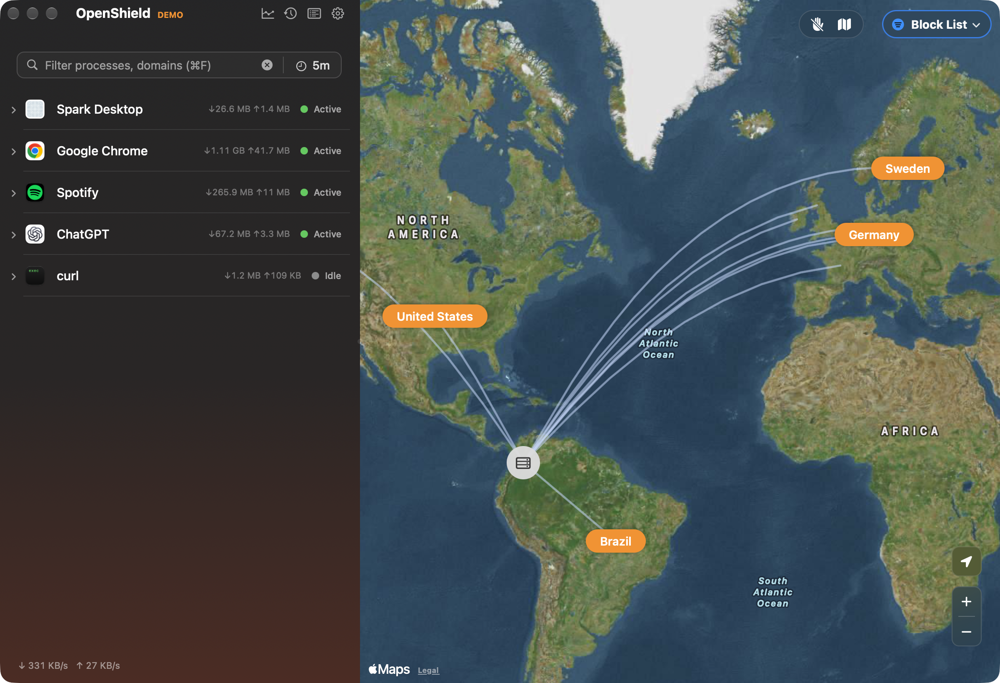

# YAS

Yet Another Shield. A network monitor and firewall for macOS, in the spirit of
Little Snitch and Tiny Shield.



YAS lists every app that talks to the network, which hosts it connects to, and
how much it sends and receives. A map shows where that traffic goes. A Network
Extension content filter lets you block it.

## What it does

- Live list of apps and processes with per-app download and upload totals,
  filterable by name or domain and by time window.
- Map of destination countries. The country lookup runs against a bundled
  DB-IP Lite database, not a web service.
- Four modes. Block List allows everything except what your rules block. Allow
  All and Block All ignore rules. Require Approval asks you about any app no rule
  covers.
- Rules per app, per domain (optionally including subdomains), or per app and
  domain together.
- Disconnect an app or a single process for 5 minutes, 15 minutes, an hour,
  until midnight, or until you reconnect it. Connections that are already open
  get cut too.
- Pause filtering for a set time from the menu bar.
- History of past connections and a traffic chart, stored in a local SQLite
  database.
- English and Spanish.

Without the filter extension running, YAS falls back to monitor-only mode. It
reads open sockets through libproc, so you still see real connections, but it
can't block anything.

## Requirements

- macOS 14 or later
- Xcode 16 or later
- [XcodeGen](https://github.com/yonaskolb/XcodeGen) (`brew install xcodegen`)

## Building

```bash
scripts/fetch-geoip.sh   # download the country database (once a month is plenty)
scripts/build.sh         # generate the Xcode project and build an unsigned Debug app
```

The app lands in `build/Build/Products/Debug/YAS.app`. `project.yml` is the
source of truth; the `.xcodeproj` is generated and not checked in.

To try the UI with made-up traffic, launch a Debug build with `-demo`:

```bash
build/Build/Products/Debug/YAS.app/Contents/MacOS/YAS -demo
```

Demo mode writes to its own database, so it never mixes with your real history.

### Running the filter

An unsigned build compiles and runs in monitor-only mode, but the system
extension won't activate. For that you need:

- an Apple Developer account, with your Team ID in `DEVELOPMENT_TEAM` in
  `project.yml` and the bundle IDs changed to ones you own
- Developer ID provisioning profiles for the app and the extension, with the
  Network Extension (content filter) capability and the app group
- the app copied to `/Applications` before you launch it

Bump `CURRENT_PROJECT_VERSION` in `project.yml` every time you install a new
build. If the version doesn't change, macOS may keep running the old extension.

A broken content filter can cut your Mac's network. Work on the extension in a
virtual machine. If something goes wrong, turn the filter off in YAS, or remove
it from the Network section of System Settings.

## Project layout

```
YAS/         AppKit app: windows, menu bar, history database, GeoIP
YASFilter/   system extension (NEFilterDataProvider) and its XPC server
Shared/      Swift package used by both: models, XPC protocols, rule engine
YASTests/    app unit tests
scripts/     build and GeoIP download scripts
```

The UI is AppKit, built in code. The extension depends only on `Shared`.

## Tests

```bash
swift test --package-path Shared
xcodebuild test -scheme YAS -derivedDataPath build CODE_SIGNING_ALLOWED=NO
```

## Credits

IP geolocation by [DB-IP](https://db-ip.com), licensed under
[CC BY 4.0](https://creativecommons.org/licenses/by/4.0/).
SQLite access through [GRDB](https://github.com/groue/GRDB.swift).
